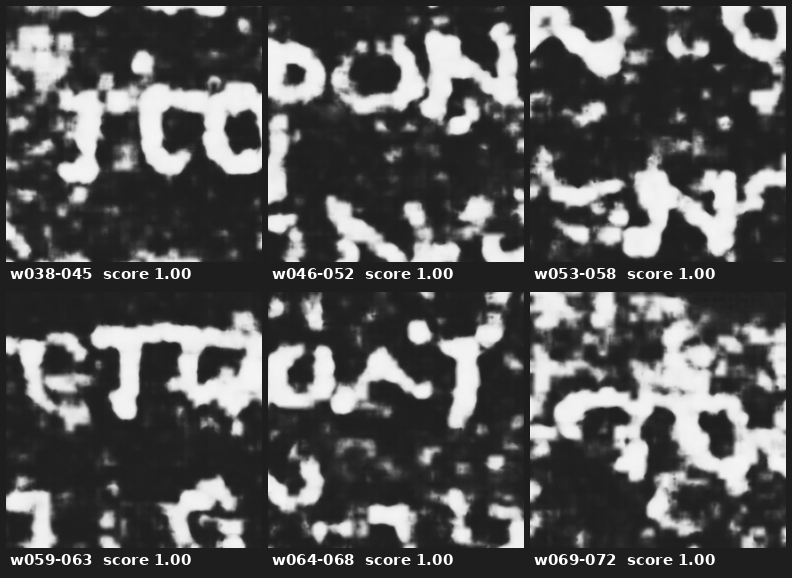
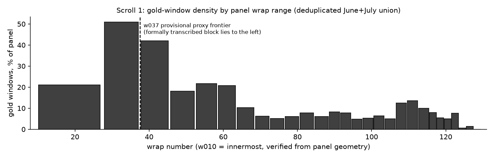
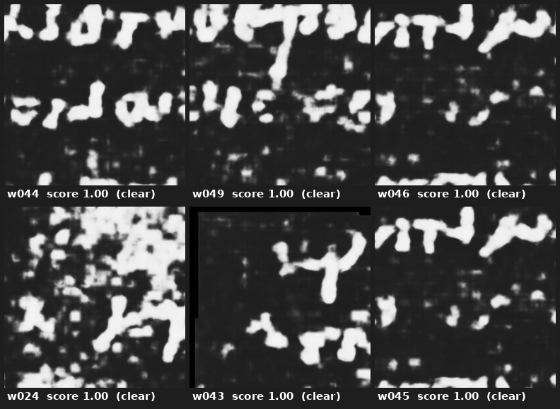

# A legibility index for the Vesuvius Challenge's official ink maps

The community's ink-detection models already tell us where the ink is. This
project answers the next question: **of all that published output, where is
there actually readable text?** A small triage classifier scores every ~1 cm
window of the official ink maps for legible-letter likelihood, a human
reviews what it flags, and the result is an index of where to look first.



*Six showcase examples, deliberately hand-picked from the top-scoring gold
windows beyond w037 (one per panel, interior windows only; selection rules
disclosed and reproducible in `figures/make_gold_examples.py`). Raw crops of
the official ds8 ink maps, resized only — no contrast or content editing.
Typical gold windows are less clean than these.*

## The two findings

**Scroll 1 (PHerc. Paris 4)** — [WRITEUP_S1_INDEX.md](WRITEUP_S1_INDEX.md):
all 78 published official ink maps scored (125,298 windows). The
deduplicated panel-series union holds **5,678 gold windows, 77.9% of them
beyond the provisional w037 proxy for the formally transcribed region**
(the Grand Prize block: 11 columns, ~5% of the scroll, physically the
innermost wraps — orientation verified from the panels' own geometry).
A further 2,460 gold windows on older
"classic" segments are reported separately (their physical overlap with the
panel series is unresolved), and 7,248 redundant re-render windows serve
only as consistency checks — nothing is silently dropped: 5,678 + 2,460 +
7,248 = 15,386 gold rows in the shipped index. The official team unwrapped
the full scroll in June 2026 and is actively transcribing, so this is
**triage today**, not discovery priority.



*The finding in one chart: gold-window density per panel across the
deduplicated series. The two innermost panels (which contain the Grand
Prize block) peak at 51%/42%, and readable density continues far past the
provisional w037 proxy, all the way to w127. One bar per panel;
regenerate with `figures/make_gold_density.py`.*

**PHerc 0139** — [WRITEUP_PHERC0139.md](WRITEUP_PHERC0139.md): the same
checkpoint, zero fine-tuning, over all 38 official maps (4,905 windows) →
63 gold windows, every one human-reviewed (single reviewer: 54 clear text,
9 possible, 0 rejected). The title region — the only formally published
text on this scroll — ranks 2nd of 38 segments as a sanity check, and **52
of the 54 clear-text windows lie outside it, across 14 wraps with no
wrap-specific public transcription located as of 2026-07-11**.



*Six of the 54 human-rated "clear text" windows on PHerc 0139's official
ink maps, hand-picked showcase examples (top scores, one per segment,
title control excluded; selection rules in
`figures/make_pherc0139_examples.py`). Raw crops, resized only.*

## The artifacts (published, verified)

| What | Where |
|---|---|
| Model card + checkpoints (`proxy_v4`, `proxy_s2s3_v1`) | https://huggingface.co/LimeGS/herculaneum-legibility-proxy |
| Training labels, 50 fiber negatives, **full 125,298-window index**, frozen evaluator, training recipe | https://huggingface.co/datasets/LimeGS/herculaneum-legibility-proxy-labels |

Everything is reproducible from public data: the dataset repo's
`summarize_index.py` recomputes every number above from the shipped index
under asserts, `test_package.py` self-checks the labels, and
`eval_checkpoint.py` deterministically reproduces the published
checkpoint's validation AUROC (0.9853457794 on 81 positives / 123
negatives). The crops pipeline regenerates the exact training inputs from
the public S3 bucket (`generate_crops.py --download`). Scope and the known
gaps (a retrained checkpoint matches in architecture and behavior, not
bit-for-bit; the `proxy_s2s3_v1` variant has a documented 169-negative gap)
are spelled out in the dataset repo's `VERIFICATION.md`.

## What it is NOT

A triage tool, not an ink detector (it runs on the official detectors'
output, never raw CT) and not a reader (it flags letter-scale connected
structure; humans and papyrologists do the reading). Windows must be ~1 cm
physical — the #1 usage error documented in the model card. Scores do not
transfer across ink-model render families.

## Repo layout

```
WRITEUP_S1_INDEX.md               the Scroll 1 index finding
WRITEUP_PHERC0139.md              the PHerc 0139 finding
docs/TRANSCRIPTION_CROSSWALK.md   formal-transcription frontier analysis (Scroll 1)
docs/CLASSIC_EQUIVALENCE.md       dedup manifest for the classic-segment bucket
docs/evidence_0139/               0139 evidence pack: transcription-status research,
                                    physical-scale audit, per-segment stats, the 63
                                    human verdicts, and the full 4,905-window index.
                                    Notes: research docs are in Spanish (snapshots,
                                    corrected in place with dated notes); in
                                    review_0139_human.json, rating 1 = clear text,
                                    2 = possible; index_0139.json rows are
                                    {segment, y, x, WIN, score, model, clamped}
figures/gold_examples.png            showcase S1 gold windows (hand-picked; see caption)
figures/pherc0139_examples.png       showcase 0139 clear-text windows (hand-picked)
figures/gold_density_by_wrap.png     the S1 finding as one chart (density vs wrap)
figures/make_*.py                    one generator per figure, selection rules inside
```

## Works on any scroll with official maps

The classifier was validated on four scrolls: Scroll 1 is its home turf
(it was trained there — held-out panels only mitigate, not remove, that
advantage), and PHerc 0139, Scroll 5 and Scroll 4 were zero-fine-tuning
transfers, the last one checked against real transcription counts
(Spearman r = 0.843 with per-wrap transcribed-letter counts, n = 18). If a scroll has official-pipeline ink maps and a known physical
scale, it can be indexed the same way — happy to run it or take a PR.

## License

Text and figures CC BY 4.0. The model/dataset artifacts are CC BY-NC 4.0
(matching the Vesuvius Challenge data they derive from). The underlying
ink maps are the Vesuvius Challenge's own published output (CC BY-NC 4.0).
